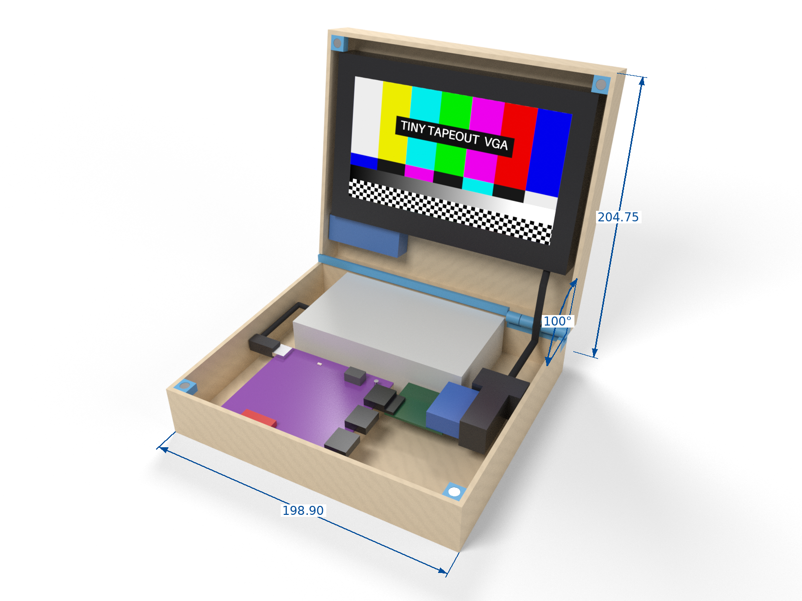
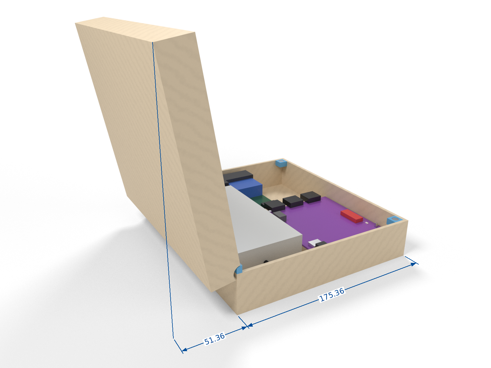
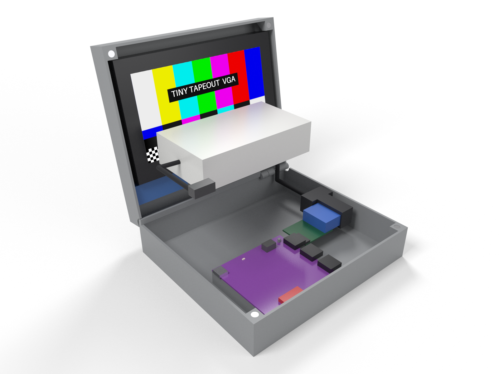
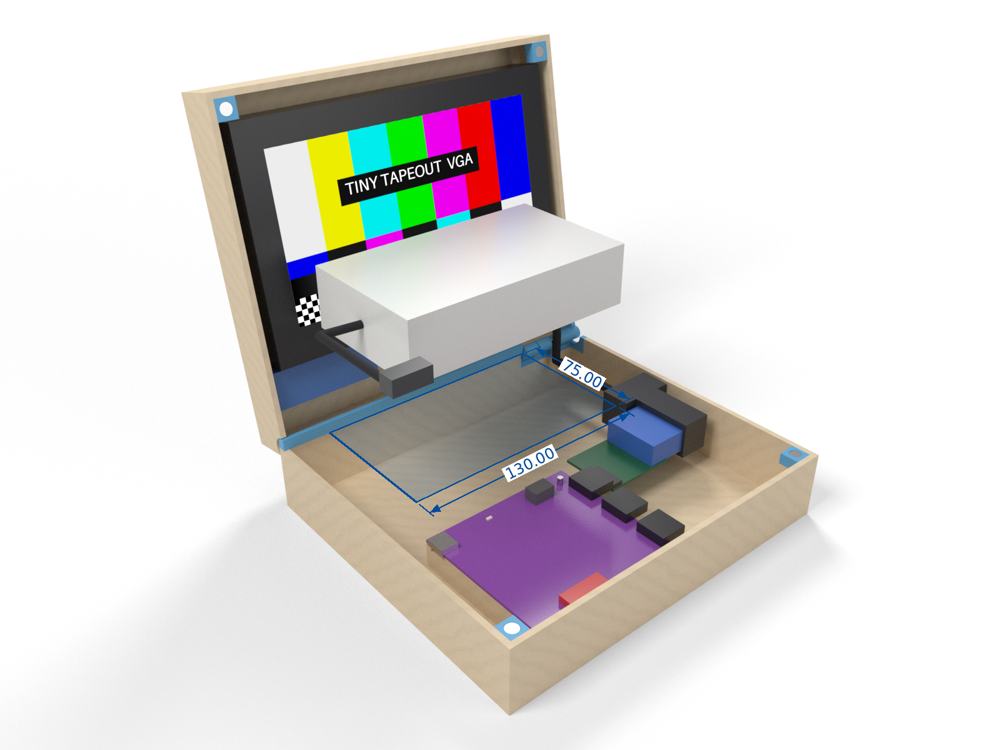
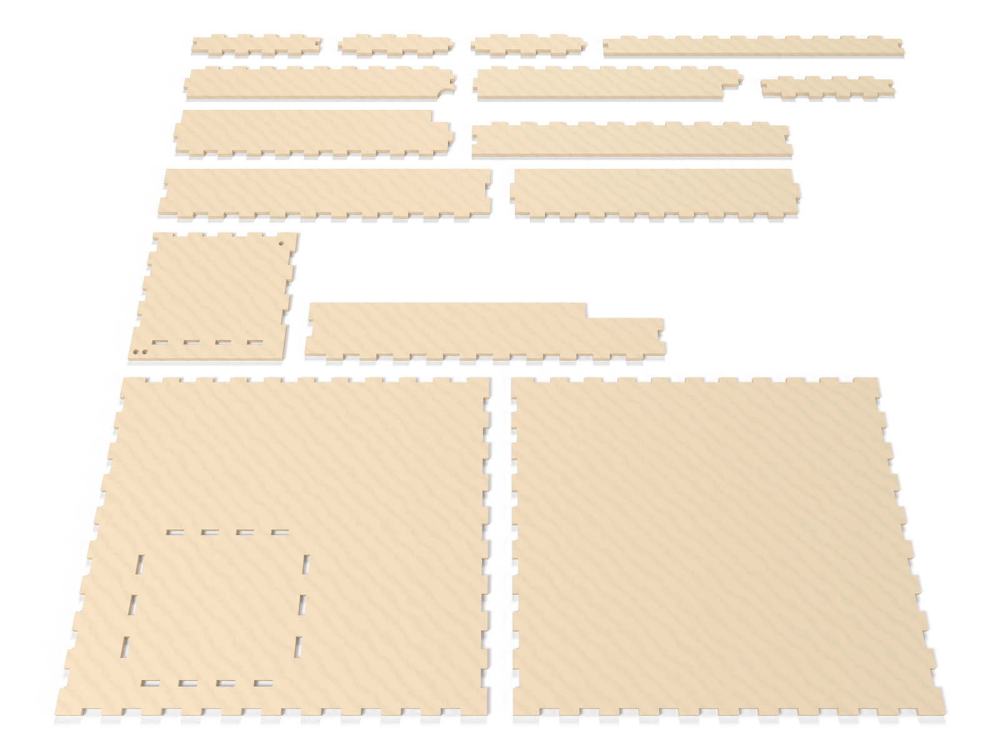

# tt-demo-box

A compact, portable, zero-setup Tiny Tapeout VGA demo station: a clamshell box with a 7" VGA
monitor taped into the lid, a Tiny Tapeout ETR dev board (with the TinyVGA Pmod) on the front of
the base, and a power bank in a bay behind it. The bank lifts out with the lid open, so it can
come out for airport security.

Open it and the lid stands at 100 degrees against a stop, showing the VGA designs cycling; the
bare dev board in front of it is what starts the conversation. Nothing to plug in. There are no
screws, nuts or inserts anywhere.

Shut, two pairs of 6 x 3 mm disc magnets in the front of the base and the lid hold it closed, so
it survives a backpack.

Size, from `make verify` (every dimension is contents + walls + 1 mm slack a side):

| Route | Closed (W x D x H) | Volume |
|---|---|---|
| 3D printed, 2.4 mm walls (220 x 220 mm bed) | 197.7 x 174.76 x 60.8 mm | 2.10 L |
| Laser-cut 3 mm plywood (300 x 200 mm bed) | 198.9 x 175.36 x 62.0 mm | 2.16 L |

The design is in [`docs/superpowers/specs/2026-11-24-compact-box-design.md`](docs/superpowers/specs/2026-11-24-compact-box-design.md).

## How it goes together

- The monitor is taped into the lid with double-sided foam tape: no pocket, bezel or insert.
- The boost module (USB to 12 V) is taped in the strip of the lid beside the monitor.
- The TT board sits on pins on a plinth, its top level with the base rim. The MT1 pin is
  loose (a printed pin in the printed route, a 3 mm rod in the laser route).
- The bank sits in its bay behind the board and lifts straight out with the lid open.
- The hinge rod (3 mm; 40.8 mm printed, 41.4 mm laser) is pressed in from the right-hand side face.
- Printed route: print the parts and glue nothing. Laser route: finger-jointed 3 mm plywood,
  wood glue; a panel over the bed is split on a glued seam.

## Choosing a bank

The box is sized for one kit. Set `DESIGN_BANK` in `demobox/layout.py` (one of the keys of
`BATTERIES`, currently `xiaomi-pb2020`), then run `make outputs sheets readme`.

## Open measurements

The full list is generated below. Two values decide the layout:

- **The monitor pigtail's minimum bend radius.** 15 mm is a placeholder. The box depth grows
  one-for-one if the real cable needs more.
- **The 90 degree VGA adapter's type and size.** A left/right-angle type is assumed; a longer
  adapter widens the box.

## Renders

| | |
|---|---|
|  |  |
|  |  |
|  |  |

Laser flat-pack layout: 

The renders are Blender Cycles images and are not reproducible byte for byte, so `make check`
does not compare `output/renders/*.png`. Everything else under `output/` is checked.

## Outputs

- `output/printed/`: STEP and STL per part, plus `assembly.step`.
- `output/laser/`: one DXF per plywood panel, `hardware.txt`, `assembly.step`, and
  `printed/` (the few printed fittings of the laser route).
- `output/sheets/`: the drawings (SVG, PDF, `previews/*.png`): general assemblies
  TDB-GA-P / TDB-GA-L, the laser cut list TDB-CUT-L, and one sheet per printed part. The PDFs
  are the files to print; the layout follows fpgas.online-mechanical.

## Bill of materials

The hardware tables below are generated from `demobox.printed.body.hardware` and
`demobox.laser.fittings.hardware` (`make readme`; `make check-readme` fails when they are stale);
the same counts are in `output/laser/hardware.txt` and on the GA sheets' parts lists.

Bought parts, both routes (one each unless the tables say otherwise):

- TT demo board v3.2 or v3.3 (85 x 80 or 85 x 85 mm) with the TinyVGA Pmod
  ([mole99/tiny-vga](https://github.com/mole99/tiny-vga)).
- One monitor, taped into the lid:
  Tim's Taobao 7" VGA car monitor (no listing; the design monitor);
  [7" car-style TFT, AliExpress 1005004614276566](https://www.aliexpress.com/item/1005004614276566.html);
  [AT070TN92 + PCB800099 bare kit, AliExpress 1005006369001145](https://www.aliexpress.com/item/1005006369001145.html).
  The two 12 V monitors run from a USB to 12 V DC (5.5 x 2.1) boost cable.
- One power bank (see [`battery-survey.md`](docs/superpowers/specs/battery-survey.md)): INIU
  P512 ([iniushop.com](https://iniushop.com)), UGREEN PB505 ([ugreen.com](https://www.ugreen.com)),
  Xiaomi 20000 integrated-cable PB2020 ([mi.com](https://www.mi.com), the design bank) or
  Anker Zolo 20K A1689 ([anker.com](https://www.anker.com)).
- Cables: slim VGA cable <= 0.5 m, a left/right-angle 90 degree VGA adapter, a USB-C
  right-angle cable, a USB-A to USB-C cable, and the USB to 12 V boost cable above.
- Double-sided foam tape (monitor and boost module), 4 magnets 6 x 3 mm (2 pairs), a 3 mm rod
  for the hinge. The laser route adds two 3 mm board-pin rods and wood glue.

Hardware, printed route:

<!-- hardware-printed:begin -->
| Qty | Part |
|---:|---|
| 4 | 6 x 3 mm disc magnet |
| 1 | 3 mm rod x 40.8 mm (hinge pin; steel, or 2.85 mm filament) |
| 1 | double-sided foam tape (VHB type), monitor back and boost module |
<!-- hardware-printed:end -->

Hardware, laser route (3 mm plywood):

<!-- hardware-laser:begin -->
| Qty | Part |
|---:|---|
| 4 | 6 x 3 mm disc magnet |
| 1 | 3 mm rod x 41.4 mm (hinge pin) |
| 2 | 3 mm rod x 19.7 mm (board pins, MT2 + loose MT1) |
| 1 | wood glue |
| 1 | double-sided foam tape (VHB type), monitor back and boost module |
<!-- hardware-laser:end -->

## Building

Clone with submodules (`git clone --recurse-submodules`, or `git submodule update --init`).
Everything runs through `uv` and `make`; there is no `pyproject.toml`.

- `make fetch`: download the upstream sources into `tmp/src` (tests need them)
- `make test`: the pytest suite without the slow tests; `make test-all`: everything
- `make verify`: dimensional checks for both routes, and the UNCONFIRMED report
- `make outputs`: STEP / STL / DXF for both routes into `output/`
- `make sheets`: the drawings (needs `inkscape`), then the sheet checks
- `make renders`: Blender renders into `output/renders/` (needs `blender`)
- `make tools`: check that `inkscape` and `blender` are installed
  (`sudo apt install inkscape blender`)
- `make check`: what CI runs: `test-all`, `verify`, `check-sheets`, `check-outputs` (rebuilds
  every STEP, STL, DXF, SVG, PDF and preview PNG into `tmp/check-outputs/` and compares them
  with `output/` byte for byte; `output/renders` is excluded) and `check-readme`

Sheets are stamped with a content hash of what they are drawn from: the first 10 hex digits
of a SHA-256 over `git rev-parse HEAD:<path>` for `demobox/`, `scripts/`, the
`vendor/fpgas.online-mechanical` pin and the `Makefile` (`+` when any of them has uncommitted
changes). Commits to the README, docs, tests or `output/` -- and squash or rebase merges that
keep the content -- leave it unchanged; after a commit that changes those sources, run
`make outputs sheets` and commit `output/` again.

CI (`.github/workflows/check.yml`) runs `make fetch check` in a Debian 13 container with
Inkscape 1.4, the same packages that drew the committed PDFs. It does not install Blender.

### Adding a monitor

The monitor is taped into the lid, so any panel that fits the lid tray works; one with
rear-facing sockets does not.

1. Add a `Monitor` entry to `MONITORS` in `demobox/parts/monitors.py`: its `key`, panel size,
   active area and offset, connector exit, power, `cable_edge`, `window`, sources, and
   `confirmed=False` until measured.
2. To build the box around it, set `DESIGN_MONITOR` in `demobox/layout.py`; `make verify`
   checks that it fits.
3. `make outputs sheets readme`: the outputs follow, and the README's UNCONFIRMED list picks up
   its placeholders.
4. `make check`, then commit the entry and `output/`.

## UNCONFIRMED figures, and what to measure

Every dimension carries a source and a `confirmed` flag. `make verify` lists the figures that
are still placeholders; the list below is generated from its output (`make readme`) and checked
by `make check`. Measure each on the real part, correct the data module, and set
`confirmed=True`.

<!-- unconfirmed:begin -->
UNCONFIRMED (14 placeholder figures; measure and confirm).

- **monitor taobao-tim**: Placeholder: depth, active offset, button position: Measure depth with calipers (20.0 is item H's rim depth); measure the active-area offset in the bezel and each button's position on the front.; Placeholder: pigtail length and exit point: Not measured. 300 mm length and 167 mm exit position are design assumptions (cable seen leaving the bottom edge near the button side in photos 1, 2, 11, but its length and offset are not read from them); measure both.
- **battery xiaomi-pb2020**: Placeholder: button position, port face: Not in the survey; measure the button and the port face.
- **USB_C_AXIS_ABOVE_PCB**: 1.6: Typical top-mount USB-C; measure J1 on a v3.2/v3.3 board.
- **TINYVGA_Z_OFFSET**: 0.0: Assumed coplanar with the host PCB; measure a plugged-in TinyVGA.
- **TAPE_T**: 1.0: Decision 3: VHB-type double-sided foam tape; 1.0 mm is typical, measure the tape bought.
- **TinyVGA heights**: Typical-part heights (placeholder): DE-15 height, plug body/height are not in the KiCad file.
- **TALLEST_COMPONENT**: 12.0 mm: 12 mm is a guess to be replaced by measuring a populated board.
- **cable vga-slim**: Placeholder: typical-part figures: Diameter, bend radius and plug body are typical values; measure the bought cable.
- **cable vga-90-adapter**: Placeholder: typical-part figures: Diameter, bend radius and plug body are typical values; measure the bought cable.; Placeholder: adapter orientation: left/right-angle type assumed (socket on the D-sub's end, facing the back of the box); check the one bought; an up/down type changes the layout
- **cable usb-c-right-angle**: Placeholder: typical-part figures: Diameter, bend radius and plug body are typical values; measure the bought cable.
- **cable usb-a-c**: Placeholder: typical-part figures: Diameter, bend radius and plug body are typical values; measure the bought cable.
- **cable usb-12v-boost**: Placeholder: typical-part figures: Diameter, bend radius and plug body are typical values; measure the bought cable.
- **cable bank-built-in**: Placeholder: typical-part figures: Diameter, bend radius and plug body are typical values; measure the bought cable.
- **cable monitor-pigtail**: Placeholder: Tim's monitor's own hard-wired cable: Placeholder: 3 x dia for a static bend; this value decides the layout (at 20 mm the VGA plug cannot sit in the bank-row corner and the box grows to about 208 x 209 mm); measure Tim's cable.
<!-- unconfirmed:end -->

## Decisions a builder should know

- The board row is at the front, the bank row behind it, long runs along X.
- The USB-C cable lands front-left of the board (the submodule's board frame is y-up, so the
  board turns 180 degrees with the Pmod edge towards the hinge).
- A left/right-angle 90 degree VGA adapter is assumed; see the open measurements above.
- The bank's end button faces a port room at the side of the base, reached with the lid open.
- The MT1 locating pin is loose, not part of the plinth.
- Laser finger joints are line-to-line: no press-fit allowance, so glue or clamp as needed.

## Licence

Licensed under the Apache License 2.0.

Board dimensions come from the `vendor/fpgas.online-mechanical` submodule, pinned at commit
`2273d7d40043b781003859c7cd4e67626b48c019`.
