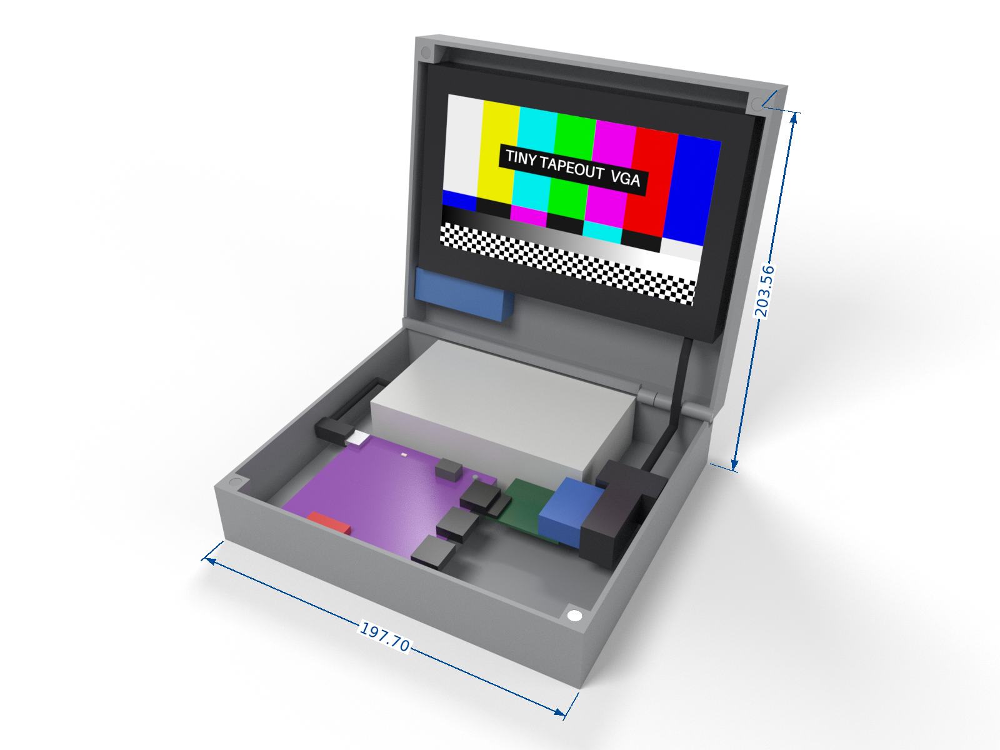
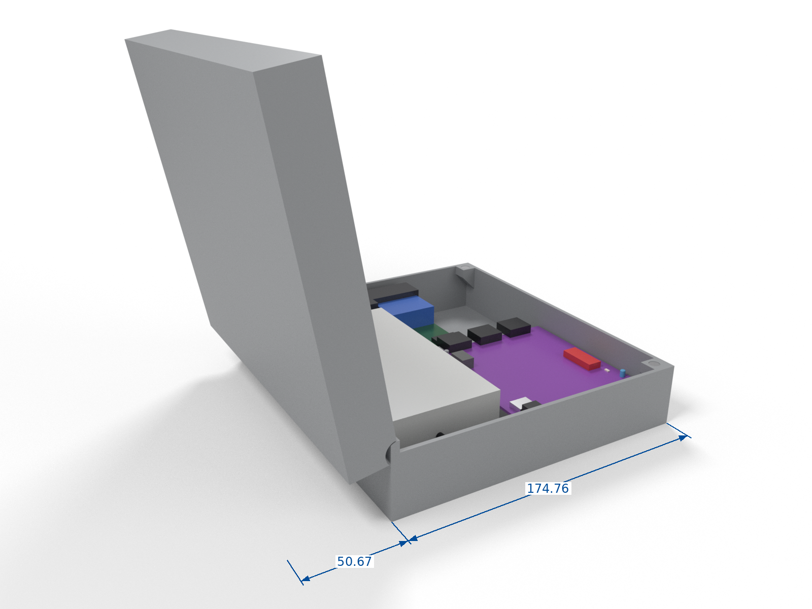
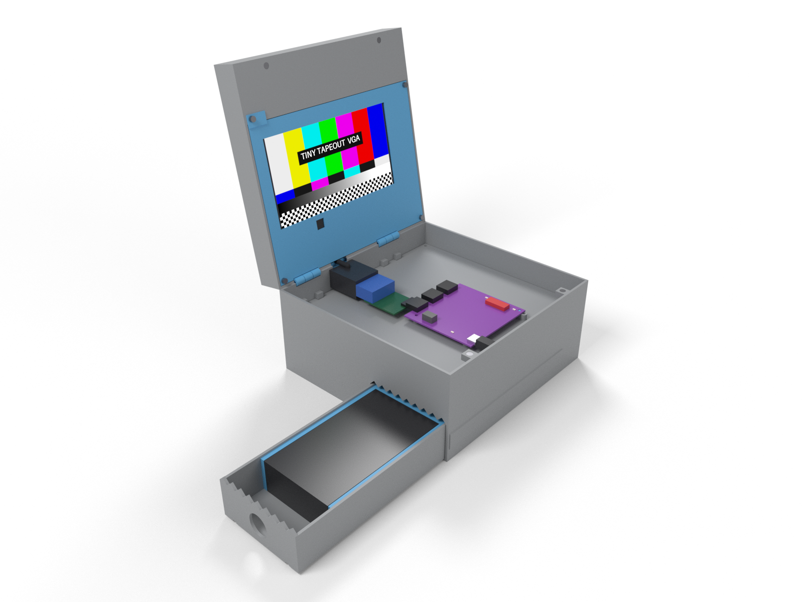
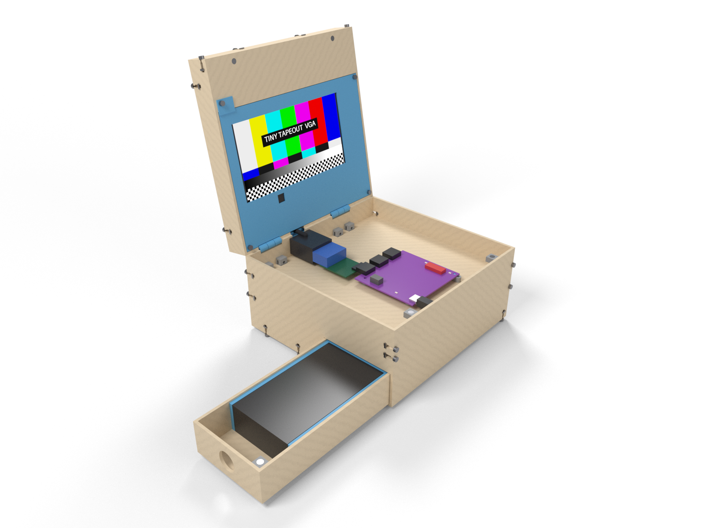
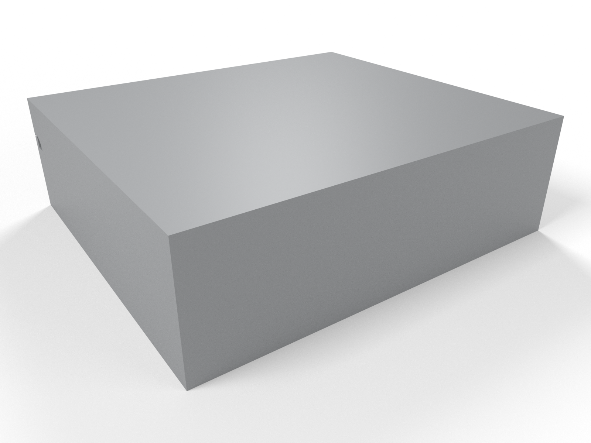
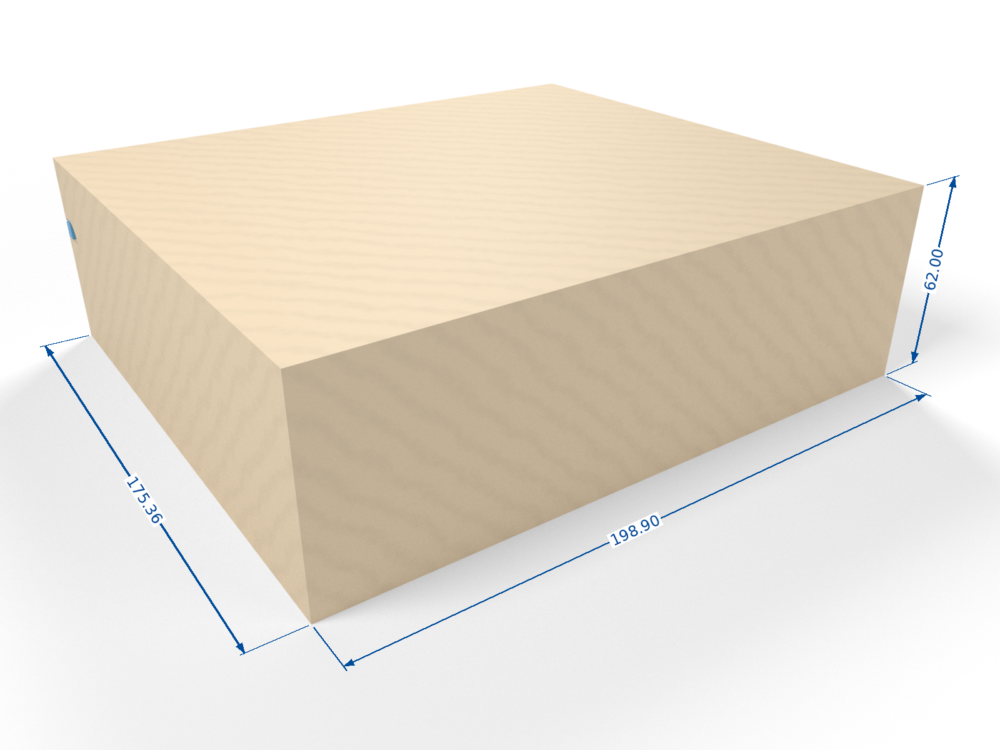

# tt-demo-box

A portable, zero-setup Tiny Tapeout VGA demo station: a small clamshell box with a 7" VGA
monitor in the lid, a Tiny Tapeout ETR dev board (with the TinyVGA Pmod) exposed on the deck,
and a power bank in a slide-out drawer underneath that comes out for airport security.

Open it and the lid stands at 100 degrees showing the VGA designs cycling; the bare dev board
in front of it is what starts the conversation. Nothing to plug in. The power bank slides out
of a drawer so it can be taken out at airport security.

Two build routes from one design: 3D printed (220 x 220 mm bed) and laser-cut 3 mm plywood
(300 x 200 mm bed).

The design is in [`docs/superpowers/specs/2026-11-23-tt-demo-box-design.md`](docs/superpowers/specs/2026-11-23-tt-demo-box-design.md).

## Renders

| | |
|---|---|
|  |  |
|  |  |
|  |  |

Laser flat-pack layout: 

The renders are Blender Cycles images and are not reproducible byte for byte, so `make check`
does not compare `output/renders/*.png`. Everything else under `output/` is checked.

## Outputs

- `output/printed/`: STEP and STL per part, plus `assembly.step`.
- `output/laser/`: one DXF per plywood panel, `hardware.txt`, `assembly.step`, and
  `printed/` (the few printed fittings of the laser route).
- `output/sheets/`: the drawings (SVG, PDF, `previews/*.png`): general assemblies
  TDB-GA-P / TDB-GA-L, the laser cut list TDB-CUT-L, one sheet per printed part, and one
  insert sheet per monitor. The PDFs are the files to print; the layout follows
  fpgas.online-mechanical.

## Bill of materials

Counts are generated (`demobox.printed.body.hardware`, `demobox.laser.fittings.hardware`, listed
in `output/laser/hardware.txt`) and checked on the GA sheets' parts lists.

Bought parts, both routes (one each):

- TT demo board v3.2 or v3.3 (85 x 80 or 85 x 85 mm) with the TinyVGA Pmod
  ([mole99/tiny-vga](https://github.com/mole99/tiny-vga)).
- One monitor (a bezel + retainer insert per monitor is printed):
  Tim's Taobao 7" VGA car monitor (no listing);
  [7" car-style TFT, AliExpress 1005004614276566](https://www.aliexpress.com/item/1005004614276566.html);
  [AT070TN92 + PCB800099 bare kit, AliExpress 1005006369001145](https://www.aliexpress.com/item/1005006369001145.html).
  The two 12 V monitors run from a USB to 12 V DC (5.5 x 2.1) boost cable.
- One power bank that fits the 158 x 82 x 34 mm bay (see
  [`battery-survey.md`](docs/superpowers/specs/battery-survey.md)): INIU P512
  ([iniushop.com](https://iniushop.com)), UGREEN PB505 ([ugreen.com](https://www.ugreen.com)),
  Xiaomi 20000 integrated-cable PB2020 ([mi.com](https://www.mi.com)) or Anker Zolo 20K A1689
  ([anker.com](https://www.anker.com)). A packing insert is printed per bank.
- Cables: slim VGA cable <= 0.5 m, a 90 degree VGA adapter, a USB-C right-angle cable
  (deck to drawer), a USB-A to USB-C cable, and the USB to 12 V boost cable above.

Hardware, printed route (M3 throughout):

| Qty | Part |
|---:|---|
| 15 | M3 heat-set insert, D4.0 x 5.7 |
| 2 | M3 x 40 bolt + nyloc (hinge pin) |
| 1 | M3 x 6 pan-head (bezel clip) |
| 3 | M3 x 6 pan-head (bezel) |
| 1 | M3 x 6 pan-head (board, MT2) |
| 4 | M3 x 6 pan-head (deck corners) |
| 6 | M3 x 8 pan-head (hinge leaves) |

Hardware, laser route (3 mm plywood, plus the printed hinge, bezel, clip, pin and packing):

| Qty | Part |
|---:|---|
| 4 | 12 x 4 mm self-adhesive rubber foot |
| 2 | 6 x 3 mm disc magnet |
| 2 | M3 nyloc nut (hinge) |
| 40 | M3 square nut |
| 1 | M3 x 10 pan-head screw (bezel clip) |
| 29 | M3 x 12 pan-head screw (T-slot) |
| 6 | M3 x 12 pan-head screw (hinge leaf) |
| 1 | M3 x 16 pan-head screw (board, MT2) |
| 2 | M3 x 40 bolt (hinge) |
| 3 | M3 x 8 pan-head screw (bezel) |
| 1 | hook-and-loop tape, 51 x 16 mm pair (boost converter) |

## Building

Clone with submodules (`git clone --recurse-submodules`, or `git submodule update --init`).
Everything runs through `uv` and `make`; there is no `pyproject.toml`.

- `make fetch`: download the upstream sources into `tmp/src` (tests need them)
- `make test`: the pytest suite without the slow tests; `make test-all`: everything
- `make verify`: dimensional checks for both routes, and the UNCONFIRMED report
- `make outputs`: STEP / STL / DXF for both routes into `output/`
- `make sheets`: the drawings (needs `inkscape`), then the sheet checks
- `make renders`: Blender renders into `output/renders/` (needs `blender`)
- `make tools`: check that `inkscape` and `blender` are installed
  (`sudo apt install inkscape blender`)
- `make check`: what CI runs: `test-all`, `verify`, `check-sheets`, `check-outputs` (rebuilds
  every STEP, STL, DXF, SVG, PDF and preview PNG into `tmp/check-outputs/` and compares them
  with `output/` byte for byte; `output/renders` is excluded) and `check-readme`

Sheets are stamped with a content hash of what they are drawn from: the first 10 hex digits
of a SHA-256 over `git rev-parse HEAD:<path>` for `demobox/`, `scripts/`, the
`vendor/fpgas.online-mechanical` pin and the `Makefile` (`+` when any of them has uncommitted
changes). Commits to the README, docs, tests or `output/` -- and squash or rebase merges that
keep the content -- leave it unchanged; after a commit that changes those sources, run
`make outputs sheets` and commit `output/` again.

CI (`.github/workflows/check.yml`) runs `make fetch check` in a Debian 13 container with
Inkscape 1.4, the same packages that drew the committed PDFs. It does not install Blender.

### Adding a monitor

Only monitors without rear-facing sockets fit.

1. Add a `Monitor` entry to `MONITORS` in `demobox/parts/monitors.py`: its `key`, a short
   unique `code` (upper-case letters and digits; it names the insert sheet `TDB-INS-<code>`),
   panel size, active area and offset, connector exit, power, `cable_edge`, `window`, sources,
   and `confirmed=False` until measured.
2. `make verify`: the window rule, insert stack and cable path are checked for it.
3. `make outputs sheets readme`: its bezel, retainer and insert sheet appear in `output/`, and
   the README's UNCONFIRMED list picks up its placeholders.
4. `make check`, then commit the entry and `output/`.

## UNCONFIRMED figures, and what to measure

Every dimension carries a source and a `confirmed` flag. `make verify` lists the figures that
are still placeholders; the list below is generated from its output (`make readme`) and checked
by `make check`. Measure each on the real part, correct the data module, and set
`confirmed=True`.

<!-- unconfirmed:begin -->
UNCONFIRMED (25 placeholder figures; measure and confirm).

- **monitor taobao-tim**: Placeholder: depth, active offset, button position: Measure depth with calipers (20.0 is item H's rim depth); measure the active-area offset in the bezel and each button's position on the front.
- **taobao-tim pigtail**: cable leaves the bottom edge; its position along the edge and the pigtail's length are unmeasured
- **monitor car-7-aliexpress**: Placeholder: active offset, button, bezel window: Not in the listing. Measure the active-area offset, the button position and the connector side on a real unit.
- **monitor kit-at070tn92**: Placeholder: panel size, board position and height: Panel ~165 x 100 x 5.7 is unconfirmed, as are the board's offset, its height (12 mm) and the connector positions. Measure a real kit.; Placeholder: driver PCB thickness, face and mounting holes: PCB assumed 1.6 mm, on the panel side of the board with its parts rearward, and M3 holes 3.5 mm in from each corner. Measure a real PCB800099.
- **kit-at070tn92 connector exit**: driver-board connector positions unmeasured; the cable is assumed to leave at the hinge end through the hinge channel
- **battery iniu-p512**: Placeholder: button position, port face: Not in the survey; measure the button and the port face.
- **battery ugreen-pb505**: Placeholder: button position, port face: Not in the survey; measure the button and the port face. The survey says 'all on top face'; read as the short top end -- ports on a broad face could not be used in any slim bay; confirm on the real unit.
- **battery xiaomi-pb2020**: Placeholder: button position, port face: Not in the survey; measure the button and the port face.
- **battery anker-zolo-20k**: Placeholder: button position, port face: Not in the survey; measure the button and the port face.
- **iniu-p512 button**: on the port end, behind the cable bay, out of reach with the drawer shut: press with drawer open
- **ugreen-pb505 button**: on the port end, behind the cable bay, out of reach with the drawer shut: press with drawer open
- **xiaomi-pb2020 button**: on the port end, behind the cable bay, out of reach with the drawer shut: press with drawer open
- **anker-zolo-20k button**: on the port end, behind the cable bay, out of reach with the drawer shut: press with drawer open
- **USB_C_AXIS_ABOVE_PCB**: 1.6: Typical top-mount USB-C; measure J1 on a v3.2/v3.3 board.
- **TINYVGA_Z_OFFSET**: 0.0: Assumed coplanar with the host PCB; measure a plugged-in TinyVGA.
- **TinyVGA heights**: Typical-part heights (placeholder): DE-15 height, plug body/height are not in the KiCad file.
- **TALLEST_COMPONENT**: 12.0 mm: 12 mm is a guess to be replaced by measuring a populated board.
- **usb-c-right-angle length**: not in the cable data; buy one long enough for the slack loop to the deck slot (see its check)
- **usb-12v-boost length**: not in the cable data; buy one long enough for the slack loop to the boost pocket (see its check)
- **cable vga-slim**: Placeholder: typical-part figures: Diameter, bend radius and plug body are typical values; measure the bought cable.
- **cable vga-90-adapter**: Placeholder: typical-part figures: Diameter, bend radius and plug body are typical values; measure the bought cable.
- **cable usb-c-right-angle**: Placeholder: typical-part figures: Diameter, bend radius and plug body are typical values; measure the bought cable.
- **cable usb-a-c**: Placeholder: typical-part figures: Diameter, bend radius and plug body are typical values; measure the bought cable.
- **cable usb-12v-boost**: Placeholder: typical-part figures: Diameter, bend radius and plug body are typical values; measure the bought cable.
- **car-7-aliexpress side connectors**: plug bodies assumed within the rim's footprint (on the rear hump); the cable's turn is counted from the panel edge
<!-- unconfirmed:end -->

## Decisions a builder should know

- The USB-C cable lands front-left of the deck (the submodule's board frame is y-up, so the
  board turns 180 degrees with the Pmod edge towards the hinge).
- A 90 degree VGA adapter is required for the base to fit a 220 mm bed.
- The power-bank buttons are behind the cable bay: press them with the drawer pulled out.
- The MT1 locating pin is a loose printed pin, not part of the deck.
- Laser finger joints are line-to-line: no press-fit allowance, so glue or clamp as needed.
- Laser T-slot nuts stand 1.25 mm proud of the panel faces (checked for clashes).

## Licence

Licensed under the Apache License 2.0.

Board dimensions come from the `vendor/fpgas.online-mechanical` submodule, pinned at commit
`2273d7d40043b781003859c7cd4e67626b48c019`.
